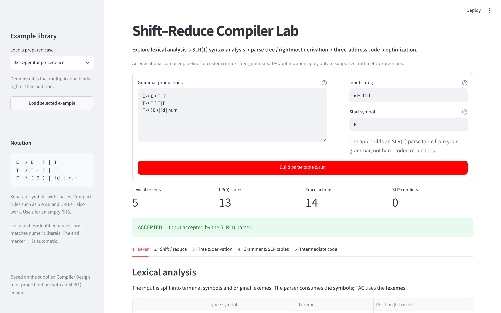

# Shift-Reduce Parsing Visualiser (SLR(1))

**An interactive parsing visualiser in pure Python: give it any context-free grammar and an input, and it builds the SLR(1) parse table, shows every shift and reduce, draws the parse tree and emits optimised three-address code. 15 automated tests pass.**



## The problem

My 2024 Compiler Design report described a shift–reduce parser, but its code was a greedy "reduce whenever the stack matches" loop. That approach reduces too early, hard-codes the start symbol and can produce wrong derivations. In 2026 I rebuilt it properly: a table-driven SLR(1) parser that either parses correctly or reports the exact conflict.

## Approach

Grammar in → FIRST/FOLLOW sets → canonical LR(0) item sets → SLR(1) ACTION/GOTO table → stack-based parse with a full trace → parse tree → rightmost derivation → three-address code → optimisation (constant folding, propagation, identities, dead-temporary removal).

## Results

- **15 of 15 automated tests pass** (`python3 -m unittest discover -s tests -v`).
- **9 ready-made examples**, including deliberate shift/reduce and reduce/reduce conflicts the parser detects instead of silently picking an action.
- `2+3*4` parses with multiplication binding tighter and optimises to `14`.

## Run it

```bash
git clone <this repo> && cd shift-reduce-parser
python3 -m pip install -r requirements.txt
python3 -m streamlit run app.py          # browser UI

python3 cli.py --example 3               # or the zero-dependency command line
python3 -m unittest discover -s tests -v # tests
```

## What it implements

| Phase/feature | Module | Behavior |
| --- | --- | --- |
| **1. Lexical analysis** | `lexer.py` | Recognizes literal grammar terminals; optionally classifies identifiers as `id` and numeric literals as `num`; records lexeme positions. |
| **2. Syntax analysis** | `grammar.py`, `parser.py` | Reads custom CFGs, computes FIRST and FOLLOW, builds canonical LR(0) item sets, produces SLR(1) ACTION/GOTO tables, shifts/reduces/accepts/rejects with a stack trace. |
| **Conflict diagnostics** | `parser.py` | Detects actual SLR(1) ACTION-table shift/reduce and reduce/reduce conflicts. Keeps prefix warnings as *hints only*. |
| **Syntax tree** | `derivation.py` | Builds the actual concrete parse tree from reductions, exports Graphviz DOT. |
| **Rightmost derivation** | `derivation.py` | Expands the rightmost nonterminal using the accepted parse tree, guaranteeing consistency with the accepted token sequence. |
| **3. Intermediate code generation** | `ir.py` | Emits three-address code for simple arithmetic expressions in an accepted tree. |
| **4. Optimization** | `ir.py` | Performs constant folding, propagation, arithmetic identities, and dead-temporary removal. |
| **Visualization** | `app.py` | Streamlit tabs for tokens, trace/step inspector, tree, rightmost derivation, FIRST/FOLLOW, LR(0) item sets, ACTION/GOTO, TAC. |

The original report's code was a simple **greedy** reduce-on-stack algorithm. Such a strategy can reduce too early, may shift the `$` end marker, hard-codes the start symbol `S`, and may produce incorrect derivations when it always chooses the first expansion. This remake instead uses generated parsing tables and reconstructs derivations from a validated parse tree.

## Grammar syntax

Write one production on each line; use `|` for alternatives:

```text
E -> E + T | T
T -> T * F | F
F -> ( E ) | id | num
```

Start symbol: `E` (default would be the first LHS); input examples: `id+id*id`, `x*(y+3)`, `2+3*4`.

Spaces between grammar symbols are recommended. Compact productions are supported for common textbook notation, e.g. `S->AB`, `E->E+T`, and `A->p`. Use `ε` for an empty RHS; `$` is added by the parser, not entered by the user. **Nonterminals must start with an uppercase letter; terminals should be lowercase, digits, or punctuation.**

For lexing, a grammar containing `id` maps identifier lexemes like `alpha` to terminal `id`, and `num` maps numeric lexemes like `2`, `3`, or `4` to terminal `num`. Other literal terminals must match the input. This is an educational grammar-aware lexer, not a complete programming-language lexer.

## Nine ready-made examples

| # | Test | Grammar/input gist | Expected |
|---|---|---|---|
| 1 | Report: two symbols | `S->AB`, `A->p`, `B->q`; `pq` | Accept; derivation `S ⇒ AB ⇒ Aq ⇒ pq` |
| 2 | Report: 1+0 | `S->A+B`, `A->1`, `B->0`; `1+0` | Accept; TAC `t1 = 1 + 0`, optimize to `1` |
| 3 | Operator precedence | `E/T/F` grammar; `id+id*id` | Accept; multiply **before** add |
| 4 | Parentheses/identifiers | `E/T/F`; `x*(y+3)` | Accept; nested tree and TAC |
| 5 | Constant folding | `E/T/F`; `2+3*4` | Accept; optimize to `14` |
| 6 | Empty RHS | `S->AB`, `A->a\|ε`, `B->b`; `b` | Accept with epsilon reduction |
| 7 | Invalid expression | `E/T/F`; `id+*id` | Reject with expected terminals |
| 8 | Shift/reduce conflict | `E->E+E\|E*E\|id` | SLR conflicts; stop at conflicting ACTION cell |
| 9 | Reduce/reduce conflict | `S->A\|B`, `A->id`, `B->id` | Conflict on `$` |

For detailed console output see `EXAMPLE_RUNS.md`.

## CLI options

```bash
python cli.py --example 1
python cli.py --example 8
python cli.py --example 3 --source 'x + y * z'
python cli.py --grammar-file my_grammar.txt --start E --source 'a+a'
```

## Reading the trace

`state stack`: DFA states, starting at `0`; `symbol stack`: input symbols and reduced nonterminals, starting with `$`; `remaining input`: token names plus `$`; `action`: shift, reduce, accept, error, or table conflict.

In a **shift**, consume a terminal and push the next state. In a **reduce** `A → β`, pop `|β|` symbols/states, build the parse-tree parent, then push `A` and `GOTO[state, A]`. The parser accepts only if the augmented start rule completes and the current lookahead is `$`.

The **rightmost derivation** reverses the semantic order of the bottom-up reduction sequence, using the tree's structure rather than trying rules until the target string appears.

## Important limits (deliberate)

- **SLR(1) is not a universal CFG parser.** Some unambiguous grammars are not SLR(1). The UI shows the actual table conflicts; it stops if a conflicting table entry is encountered. It does not silently choose an arbitrary action.
- **Prefix warnings are not an ambiguity test.** `S -> A a | A`, `A -> b` has a common-prefix hint, but no SLR conflict. A real grammar conflict is detected using parser states and FOLLOW sets, not the presence of shared prefixes alone.
- **TAC is optional and restricted to arithmetic parse-tree shapes.** Accepted arbitrary grammars (such as `S -> A B`) have no defined arithmetic semantics, so TAC is skipped.
- **The lexer is purposely lightweight.** Quoted string literals, programming-language comments, complex keywords, negative-number lexical policy, and full semantic type checking are outside scope.
- **This is a visualizer, not a production compiler.** It does not emit machine code, and optimization assumes pure arithmetic expressions (no side effects).
- Safety guards limit the number of grammar rules, LR(0) states, input tokens, and parsing steps. The app does not run the supplied source as Python or evaluate arbitrary strings.

## Project tree

```text
shift-reduce-parser/
├── app.py                   # Streamlit UI
├── cli.py                   # Standard-library console runner
├── grammar.py               # CFG grammar parser, FIRST/FOLLOW, prefix hints
├── lexer.py                 # Tokenizer
├── parser.py                # LR(0) automaton + SLR(1) parse engine
├── derivation.py            # Rightmost derivation + Graphviz DOT
├── ir.py                    # TAC + optimizer
├── samples.py               # Nine preconfigured examples
├── tests/
│   └── test_compiler.py     # Automated correctness tests
├── requirements.txt
├── EXAMPLE_RUNS.md
├── PROJECT_WALKTHROUGH.md
├── portfolio/               # website data and facts
└── README.md
```

## Credits

Compiler Design coursework, B.Tech CSBS, 2024; rebuilt as a working tool in 2026.

---
**Shubham Tanna** · Python, Streamlit, automated testing
<!-- SITE_LINK:work -->
